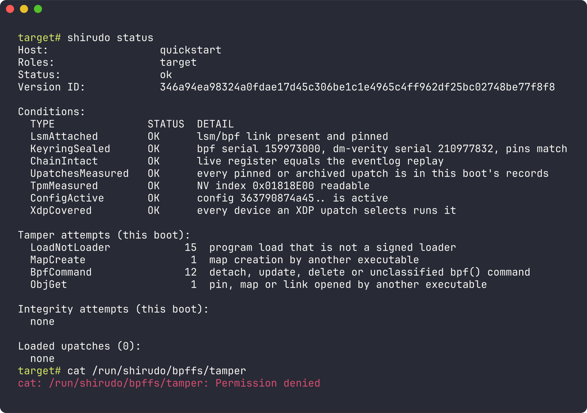
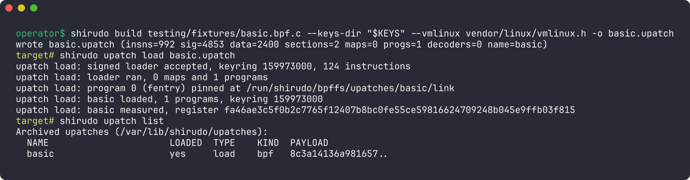
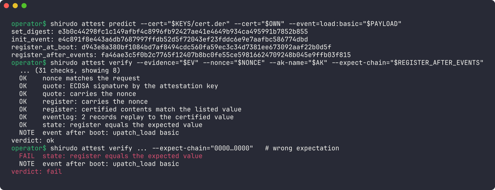
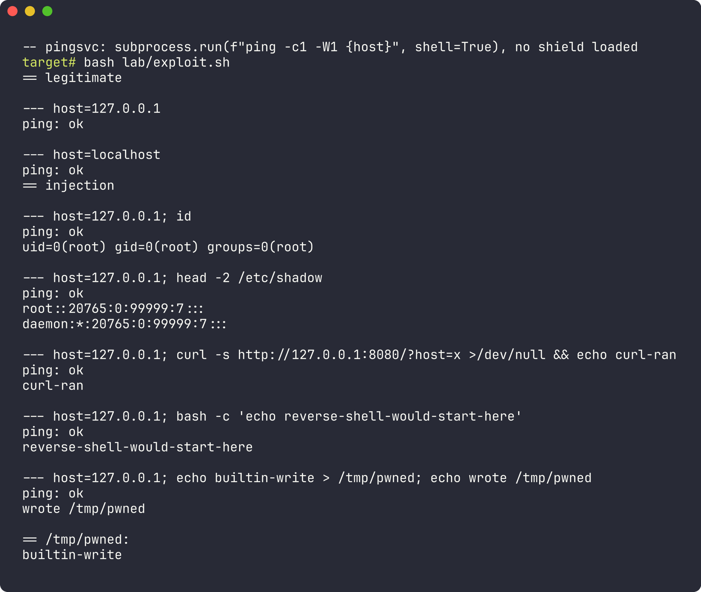
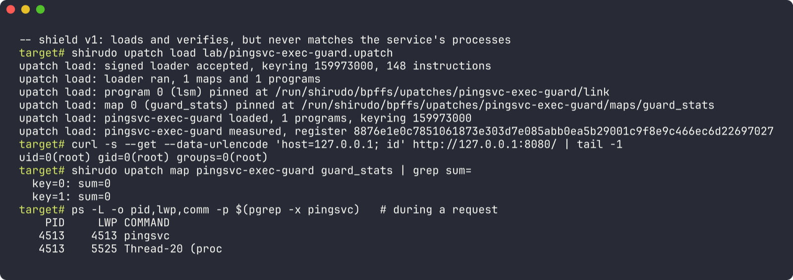
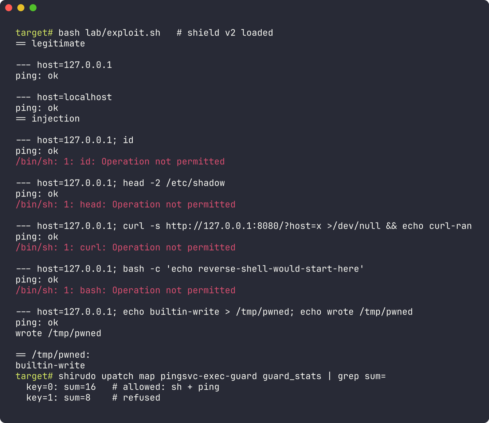
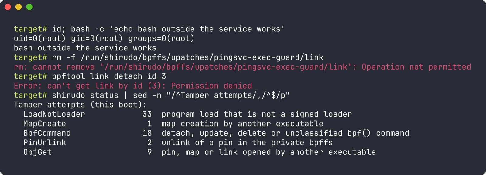
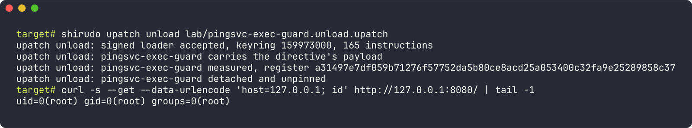

On Monday, OpenAI and Cisco announced [Shirudo](https://github.com/shirudo-dev/shirudo), an open source Linux platform where AI agents write eBPF "shields" that block an exploit while the real patch is still on its way. The headline demo had Codex generate a shield that stopped a Java4Shell exploit against a running Elasticsearch, [without a restart](https://linuxiac.com/cisco-and-openai-unveil-shirudo-an-ebpf-based-linux-security-platform/). The press coverage is mostly that one sentence repeated.

I wanted to see what's under it, so I built it. A day later I had a Shirudo target running on Azure, attested with its TPM, and protected by a shield that an AI agent wrote against a command-injection bug I planted. The first version of that shield loaded cleanly, passed the kernel verifier, and blocked absolutely nothing. That turned out to be the most useful thing I learned, so this post spends some time on it.

Everything below comes from a lab I ran on 2026-11-24 against Shirudo `main` at commit `6514073a`. The output is pasted from those sessions.

## What Shirudo actually is

Shirudo (シールド, "shield") is a rewrite of [Tetragon](https://isovalent.com/blog/post/cisco-openai-shirudo/), Isovalent's eBPF runtime security tool, rebuilt around one idea: small, signed BPF programs, called **upatches**, that you can load into a running kernel to observe or refuse a specific behavior. The AI part is that these programs are small and self-contained enough for an agent to write, build and test, and the repository ships the agent instructions to do it.

What makes it different from just running `bpftool prog load` is everything around the program:

- **Operator and target.** You build and sign on an operator host. Targets only load what your key signed. The signing code lives in a separate helper, `shirudo-build`, that never ships to a target.
- **Signed loaders and a sealed keyring.** Every load goes through a loader program the kernel verifies against a `.bpf` keyring that `shirudo init` seals at boot. After that, root on the target can't load its own BPF, detach Shirudo's programs or read its maps.
- **TPM measurement.** Each load and unload extends a TPM-backed register, and `shirudo attest` hands you evidence that you verify offline.
- **Pull-based delivery.** Packages (`.bee` files) live in OCI registries; targets pull them, and telemetry goes to an OpenTelemetry collector. It's the same signed-artifact-in-a-registry model I used for [signing container images with Cosign and Sigstore](/signing-container-images-cosign-sigstore/), applied to kernel code.
- **Java upatches.** Beyond kernel hooks, signed Java agents guard application code. That's the Java4Shell demo.

It's BSD-2-Clause, with the BPF programs dual BSD/GPL. And the README is blunt about the status: **pre-release**, not ready for production.

## The catch: the kernel

Before you plan a rollout, read the [system requirements](https://docs.shirudo.dev/operate/plan/system-requirements.html). A target needs a **bpf-next kernel with the signed-loader ABI plus Shirudo's own kernel patches** (new LSM hooks such as `tpm_command` and `mm_read_access`, sleepable inode hooks, and more), and a TPM 2.0. No distribution kernel has that today. There's no compatibility mode and no fallback.

So for now, "trying Shirudo" means running its test VM: a QEMU guest that boots the project's CI kernel with a software TPM (`swtpm`) and enforces the same policy a production target would. That guest needs a Linux host with KVM.

My Mac is an M1, and the macOS path needs an M3 or later for nested virtualization (plus about 100 GiB of free disk). I used an Azure VM instead. The Dv5 series supports nested virtualization, and that includes the default Trusted Launch security type.

## Building the operator host on Azure

The repo's Lima template (`infra/lima/shirudo.yaml`) lists everything the operator host needs, so I turned it into cloud-init for an x86-64 Ubuntu 26.04 VM. The important parts:


#cloud-config
write_files:
  - path: /etc/security/limits.d/90-shirudo-memlock.conf
    content: "* - memlock unlimited\n"           # shirudo refuses to run without it
  - path: /etc/udev/rules.d/90-shirudo-kvm.rules
    content: 'KERNEL=="kvm", GROUP="kvm", MODE="0660"'
runcmd:
  - |
    apt-get install -y --no-install-recommends build-essential pkg-config git jq \
      libssl-dev libcurl4-openssl-dev libelf-dev libluajit-5.1-dev libtss2-dev \
      qemu-system-x86 qemu-utils swtpm swtpm-tools tpm2-tools libtss2-tcti-swtpm0t64 \
      cloud-image-utils libguestfs-tools dracut-core cryptsetup-bin docker.io ...
    usermod -aG kvm,docker azureuser
    sudo -u azureuser git clone https://github.com/shirudo-dev/shirudo /home/azureuser/shirudo
    cd /home/azureuser/shirudo
    sh .github/scripts/install-clang.sh                 # clang/LLVM 23 from apt.llvm.org
    sh .github/scripts/install-static-libcrypto-deps.sh



az network nsg create -g rg-shirudo-lab -n shirudo-operator-nsg
az network nsg rule create -g rg-shirudo-lab --nsg-name shirudo-operator-nsg -n ssh-from-me \
  --priority 100 --source-address-prefixes "$(curl -s https://ifconfig.me)/32" \
  --destination-port-ranges 22 --protocol Tcp --access Allow

az vm create -g rg-shirudo-lab -n shirudo-operator \
  --image Canonical:ubuntu-26_04-lts:server:latest --size Standard_D8s_v5 \
  --os-disk-size-gb 128 --storage-sku Premium_LRS \
  --admin-username azureuser --ssh-key-values ~/.ssh/id_ed25519.pub \
  --nsg shirudo-operator-nsg --custom-data cloud-init.yaml


The VM came up with `/dev/kvm` and the `vmx` flag, and cloud-init finished in about two minutes, since clang 23 comes prebuilt from apt.llvm.org. Then the quickstart, as written:


cd ~/shirudo
testing/vm/kernel-artifact.sh fetch            # pinned CI kernel, SHA-256 checked
make && make shirudo-build
export PATH="$PWD:$PWD/tools/shirudo-build:$PATH"
make -C testing vm VM_NAME=quickstart          # builds the image + bundle, boots the target


One thing bit me here, and the docs don't mention it because a desktop session never hits it. `make vm` starts QEMU and swtpm as `systemd --user` units. When my SSH session ended, systemd tore down the user manager and the target with it (`qemu-system-x86_64: terminating on signal 15 from pid ... (/usr/lib/systemd/systemd)`). On a remote operator host, enable lingering first:


sudo loginctl enable-linger azureuser


## A protected target

The target boots Ubuntu 26.04.1 on kernel `7.4-shirudo-ci-20261123`. `shirudo init` ran from the initrd, sealed the keyrings, attached its LSM programs and bound the TPM register before the root filesystem took over. Inside the target, the `shirudo` you call has to be the binary from the runtime image. A byte-identical copy at another path gets `shirudo: image state: Permission denied`, because the LSM grants access to Shirudo's state by where the binary was executed from, not by what it contains.

The tamper counters were already non-zero before I did anything: other software on the guest had tried to load BPF that wasn't a signed loader, and got refused. Root reading one of Shirudo's pins is refused too, and counted.

## Sign, load, attest, unload

The quickstart's first upatch is deliberately boring, an `fentry` on `do_nanosleep()` that returns 0. The point is the lifecycle. You sign on the operator, and the kernel checks the loader's signature against the sealed keyring on the target. Then shirudo pins the link and extends the TPM register:

Then the part I'd show to an auditor. You generate a nonce on the operator, ask the target for evidence, and predict the register value from things you already know: the enrolled certificates and the payload digest of what you loaded. `attest verify` checks the TPM's signatures, the nonce, the eventlog replay and the final value. When I passed it a wrong expected value on purpose, it failed:

Unloading needs a signed directive that names the exact payload, so nobody can unload "whatever is called `basic`" with a different artifact. The register then moves forward to a third value; it doesn't roll back until the TPM resets at the next boot.

## The scenario: a command injection with no patch yet

For the shield I wanted a bug that's boring and common, because that's what you actually face on a Friday afternoon. Meet `pingsvc`, a network diagnostics endpoint with the oldest mistake in Python:


import ctypes, http.server, subprocess, urllib.parse

ctypes.CDLL(None).prctl(15, b"pingsvc", 0, 0, 0)   # PR_SET_NAME: comm = "pingsvc"

class Handler(http.server.BaseHTTPRequestHandler):
    def do_GET(self):
        qs = urllib.parse.parse_qs(urllib.parse.urlparse(self.path).query)
        host = qs.get("host", ["127.0.0.1"])[0]
        r = subprocess.run(f"ping -c1 -W1 {host}", shell=True, capture_output=True, text=True)
        self.send_response(200)
        self.end_headers()
        self.wfile.write((r.stdout + r.stderr).encode())

http.server.ThreadingHTTPServer(("127.0.0.1", 8080), Handler).serve_forever()


`host=127.0.0.1; id` runs `id`. Without a shield, as root on the target:

The real fix is one line (`subprocess.run(["ping", "-c1", "-W1", host])`), but pretend the service belongs to another team, the release train left yesterday, and you need something between now and next week.

## Letting an agent write the shield

The repository is set up for agents. `CLAUDE.md` is a symlink to `AGENTS.md`, and `.agents/skills/` holds skills for writing upatches, testing, fuzzing and auditing. I gave Claude Code the scenario and asked it to write a shield following the `upatch` skill. The skill is worth reading on its own, because it encodes decisions a human would get wrong too:

- *"Refuse an operation in an `lsm` program wherever a hook covers it."* `fmod_ret` can be skipped by the kernel when the program is already running on that CPU, and then the call goes through.
- Plain C against `vmlinux.h` with CO-RE, never a hard-coded struct offset.
- Do the cheapest test first and return early: the hook runs for every event on the machine.
- Know the target's preemption model before sharing state. Here the target is `SMP PREEMPT`, so a per-CPU counter still needs an atomic add.

The design it settled on: hook `bprm_check_security`, which runs on every `execve()` before the new image loads. For processes that descend from `pingsvc`, allow only the two programs the feature needs, the shell (`dash`) and `ping`, and return `-EPERM` for everything else. A per-CPU map counts allowed and refused execs.


// SPDX-License-Identifier: GPL-2.0 OR BSD-2-Clause
#include "vmlinux.h"
#include <bpf/bpf_core_read.h>
#include <bpf/bpf_helpers.h>
#include <bpf/bpf_tracing.h>

#define EPERM		1
#define MAX_DEPTH	8
#define NAME_LEN	16

char _license[] SEC("license") = "Dual BSD/GPL";

enum { STAT_ALLOWED, STAT_REFUSED, STAT_MAX };

struct {
	__uint(type, BPF_MAP_TYPE_PERCPU_ARRAY);
	__uint(max_entries, STAT_MAX);
	__type(key, __u32);
	__type(value, __u64);
} guard_stats SEC(".maps");

static __always_inline bool name_is(const char *name, const char *want, int len)
{
	for (int i = 0; i < len; i++)
		if (name[i] != want[i])
			return false;
	return true;
}

static __always_inline bool in_service(struct task_struct *task)
{
	char comm[NAME_LEN];

	for (int depth = 0; depth < MAX_DEPTH && task; depth++) {
		BPF_CORE_READ_STR_INTO(&comm, task, group_leader, comm);
		if (name_is(comm, "pingsvc", sizeof("pingsvc")))
			return true;
		task = BPF_CORE_READ(task, real_parent);
	}
	return false;
}

/* The file being executed must be bin/dash or bin/ping (usr-merged /bin). */
static __always_inline bool exec_allowed(struct linux_binprm *bprm)
{
	struct dentry *dentry = BPF_CORE_READ(bprm, file, f_path.dentry);
	char name[NAME_LEN] = {}, dir[NAME_LEN] = {};

	bpf_probe_read_kernel_str(name, sizeof(name),
				  BPF_CORE_READ(dentry, d_name.name));
	bpf_probe_read_kernel_str(dir, sizeof(dir),
				  BPF_CORE_READ(dentry, d_parent, d_name.name));
	if (!name_is(dir, "bin", sizeof("bin")))
		return false;
	return name_is(name, "dash", sizeof("dash")) ||
	       name_is(name, "ping", sizeof("ping"));
}

static __always_inline void count(__u32 key)
{
	__u64 *value = bpf_map_lookup_elem(&guard_stats, &key);

	if (value)
		__sync_fetch_and_add(value, 1);
}

SEC("lsm/bprm_check_security")
int BPF_PROG(pingsvc_exec_guard, struct linux_binprm *bprm, int ret)
{
	if (ret)
		return ret;
	if (!in_service(bpf_get_current_task_btf()))
		return 0;
	if (exec_allowed(bprm)) {
		count(STAT_ALLOWED);
		return 0;
	}
	count(STAT_REFUSED);
	return -EPERM;
}


Building and signing it is the same two commands as the quickstart, plus the unload directive that I generate up front so the way back is ready before the shield goes on:


KEYS=/tmp/shirudo-test-vm-private-$(id -u)/operator-keys/keys
shirudo build lab/pingsvc-exec-guard.bpf.c --keys-dir "$KEYS" \
  --vmlinux vendor/linux/vmlinux.h -o lab/pingsvc-exec-guard.upatch
# wrote lab/pingsvc-exec-guard.upatch (insns=1184 sig=4853 ... maps=1 progs=1 ... name=pingsvc-exec-guard)

PAYLOAD=$(shirudo upatch info --json lab/pingsvc-exec-guard.upatch | jq -r .payload_sha256)
shirudo build --unload pingsvc-exec-guard --payload-sha256 "$PAYLOAD" \
  --keys-dir "$KEYS" -o lab/pingsvc-exec-guard.unload.upatch


## Version 1 loaded fine and did nothing

The code above is version 2. Version 1 was identical except for one line in `in_service()`: it read `task->comm` instead of `task->group_leader->comm`. It compiled, signed, passed the verifier on the target, and showed up as `success` in `shirudo status`. Then the exploit ran exactly as before, and the counters said why:

Zero allowed, zero refused: the shield never recognized a single process as part of the service. Two things combine here:

1. Python 3.14 names its OS threads. The request runs in a worker thread whose `comm` is `Thread-20 (proc`, not `pingsvc`. `prctl(PR_SET_NAME)` only renamed the main thread.
2. A child's `real_parent` is the *thread* that forked it. Walking up from `sh` goes to `Thread-20 (proc`, then straight to the shell that launched the service. The thread group leader, the one called `pingsvc`, is never on that path.

Checking `group_leader->comm` at each level fixed it. I'd usually file this under "bug in the demo", but it's the strongest argument I can make about this whole category of tool. A shield passing the build, the signature check and the kernel verifier tells you it's *safe to load*. It tells you nothing about whether it *works*. If I'd tested only the legitimate traffic, which also behaved identically, v1 would have looked perfect. You need the exploit in the test loop, and you need the shield to count what it decides.

## Version 2 blocks the exploit, not the feature

Every injected program now dies at `execve()` with `Operation not permitted`. That covers `id`, `head /etc/shadow`, `curl` and the `bash -c` that would have become a reverse shell. Both legitimate requests keep working, and the counters show 16 allowed execs (a shell and a ping per request) and 8 refused. Outside the service nothing changed: from a root shell, `id`, `curl` and `bash` ran normally.

Look at the last injection, though. `echo builtin-write > /tmp/pwned` still wrote the file, because `echo` and output redirection are shell builtins and never call `execve()`. That's the honest limit of an exec allowlist. A complete shield for this bug would also restrict what the service's process tree can open for writing, which is what the repo's `app-sandbox` upatch does for web servers. I left it out on purpose, because it shows how narrow a "targeted mitigation" really is.

## Root can't take it off

This is where Shirudo earns its complexity. With the shield loaded, I tried to remove it the ways a root attacker would:

Unlinking the pin and detaching the link through `bpftool` both fail, and both show up in the tamper counters. The only way to remove the shield is the signed unload directive:

The exploit works again after the unload, which is the last check I wanted: the block came from the shield, not from something else in the environment.

## What I'd tell a team considering it

**It's a delivery and integrity system first, an AI demo second.** The agent wrote about 80 lines of C in a few minutes, and a human could have too. What I can't easily build myself is everything around it: a signature check enforced by the kernel, a sealed keyring, root unable to detach it, TPM evidence of exactly what's loaded, and pull from an OCI registry. That's what makes it reasonable to *distribute* a mitigation to thousands of hosts, which is where Cisco and OpenAI want to take it, shipping shields alongside vulnerability disclosures. The repo already points in that direction: its shield catalog matches packages to advisories through SBOM scans, the same inventory I built with [Trivy and Syft](/sbom-trivy-syft/).

**An AppArmor profile could have stopped this exploit.** I won't pretend otherwise. A profile for the service allowing only `dash` and `ping` gets you the same result on a stock kernel today. Shirudo's advantages are that the policy is code an agent can generate per vulnerability, that it can target things AppArmor can't express (kernel code paths, JVM internals), and the root-proof, attested delivery. Whether that's worth a patched kernel depends on your fleet.

**The skepticism is fair.** Upwind's CEO told [SecurityWeek](https://www.securityweek.com/openai-cisco-unveil-open-source-tool-to-shield-unpatched-linux-systems/) that writing sensitive kernel code on the fly and deploying it straight to runtime "is a very risky concept". The design answers part of that: the verifier and the signed loader make a bad shield fail to load rather than crash the kernel. My v1 shows the part it doesn't answer: a shield can be safe and useless at the same time. The review and the exploit test are still on you, and an agent should never be the one holding the signing key.

**Not production yet.** It's pre-release, and it needs a custom kernel: hooks like `mm_read_access` and `tpm_command` come from Shirudo's own patch set, not from any kernel you can install from your distribution. Run it in a lab, read the [threat model](https://docs.shirudo.dev/security/threat-model.html), and watch where the kernel patches go.

## Running it yourself

The whole lab took an afternoon on one `Standard_D8s_v5` in `eastus`, at a few dollars of compute. The [Isovalent online lab](https://labs.isovalent.com/#/lab/shirudo-getting-started) is the zero-cost way to try the quickstart in a browser. Delete the resource group when you're done:


az group delete -n rg-shirudo-lab --yes --no-wait


If you work with runtime security already, the mental model is close to Falco and Tetragon, with enforcement added. My posts on [getting started with Falco](/falco-runtime-security-kubernetes/) and [Falco rules and Sidekick alerting](/falco-rules-sidekick-alerting/) cover the detection half of that story.

## Wrapping up

We built a Shirudo operator host on Azure with nested virtualization and booted a protected target with a software TPM. We took a upatch through signing, loading, offline TPM attestation and a signed unload. Then an AI agent, working from the repo's own `upatch` skill, wrote a BPF LSM shield for a command-injection bug. The first version passed every check except the one that mattered. The second blocked every injected program, left the feature and the rest of the host alone, and couldn't be removed by root.

Try writing a shield for something you actually run, and put the exploit in the test loop before you trust the green `success` in `shirudo status`.

Happy scripting!
